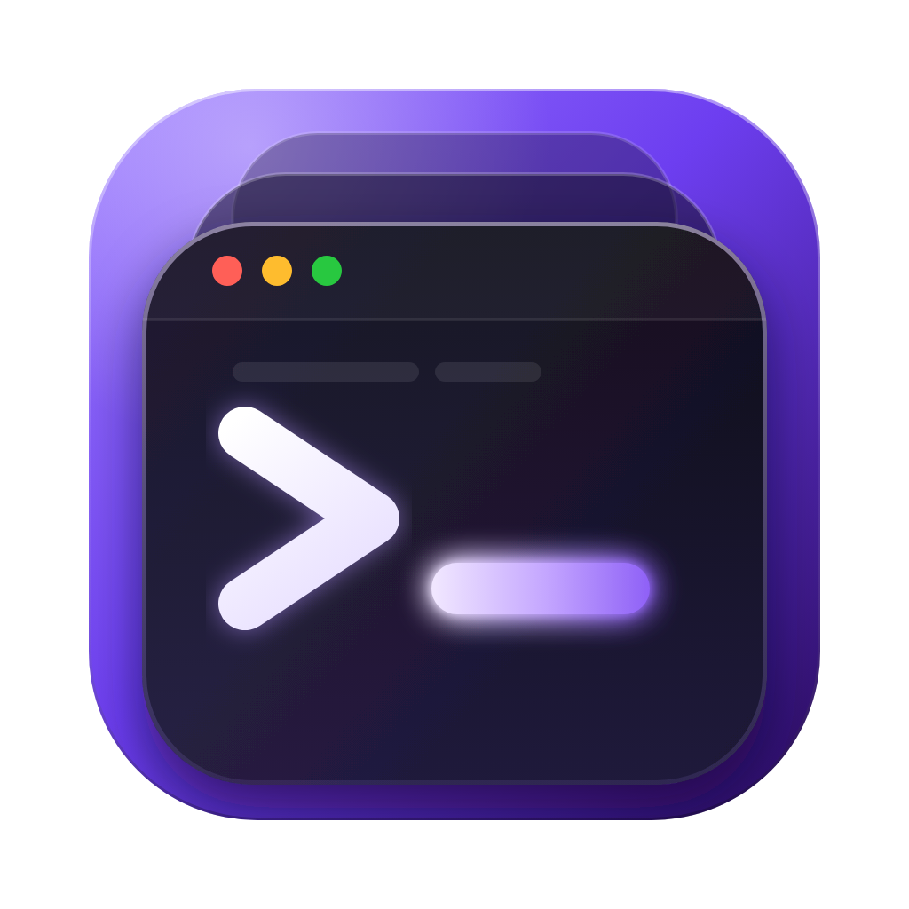

<div align="center">



# Terminyxx

**A fast, private SSH terminal, SFTP file manager and RDP launcher for Windows and macOS.**

[](https://github.com/Intteger157/terminyxx/actions/workflows/ci.yml)
[](https://github.com/Intteger157/terminyxx/releases)
[](LICENSE)


</div>

---

Terminyxx keeps every remote machine you work with in one window: SSH sessions in split panes, a
dual-pane SFTP manager, RDP launching and a host library you can import from the tools you already use.
It is built on [Wails](https://wails.io) (Go backend, native WebView) so it starts instantly, stays
small, and needs no Electron or bundled browser.

## Features

### Terminal
- **xterm.js terminals** with tabs, **split panes** (right / down), drag-and-drop layout and live theming
- Terminal themes, keyword highlighting and a command palette (`Ctrl+Shift+P`) with quick-connect for `user@host:port`
- Auth by password, keyboard-interactive, key files (OpenSSH, **PuTTY `.ppk`**) and **ssh-agent** (including the Windows OpenSSH agent)
- Host key verification with a trusted-hosts manager

### SFTP
- Dual-pane **Total Commander-style** file manager (F3 / F5 / F6 / F7 / F8, multi-select, drag between panes)
- Recursive, concurrent transfers with progress and cancel; drop files from Explorer / Finder to upload
- Reuses the terminal's SSH connection, so no second login

### Host library
- Folders, colors, drag-and-drop ordering; SSH and RDP hosts side by side
- Passwords are stored in the **OS keychain** (Windows Credential Manager / macOS Keychain), never in the database
- **Import** from OpenSSH config, MobaXterm, PuTTY, KiTTY, WinSCP, SecureCRT, Tabby, FileZilla and `.rdp` files

### RDP
- One-click launch through the native client (`mstsc` on Windows, the system RDP client on macOS)

### Security
- **App lock** with an Argon2id master password, auto-lock on inactivity / minimize / sleep, **Windows Hello** and **Touch ID**
- **Hide from screen capture and screen sharing**, with a notice when sharing is detected
- **Output masking** for secrets and tokens in terminal output
- Paste protection, OSC 52 policy, clipboard auto-clear, modern-only SSH algorithms by default
- Strict Content Security Policy in production builds

## Download

Grab the latest build from the [Releases page](https://github.com/Intteger157/terminyxx/releases):

| Platform | File |
| --- | --- |
| Windows x64 | `Terminyxx-<version>-windows-x64-setup.exe` or `-portable.exe` |
| Windows ARM64 | `Terminyxx-<version>-windows-arm64-setup.exe` or `-portable.exe` |
| macOS (Intel and Apple Silicon) | universal build |

Every release includes `SHA256SUMS.txt` for verification.

## Keyboard shortcuts

App shortcuts use `Ctrl+Shift`, so plain `Ctrl` keys stay with your shell (on macOS, lock is `Cmd+L`).

| Shortcut | Action |
| --- | --- |
| `Ctrl+Shift+P` | Command palette |
| `Ctrl+Shift+T` / `W` | New connection / close tab |
| `Ctrl+Shift+D` / `E` | Split right / down |
| `Ctrl+Shift+F` | Toggle SFTP panel |
| `Ctrl+Shift+B` | Toggle sidebar |
| `Ctrl+Shift+[` / `]` | Previous / next tab |
| `Ctrl+Shift+L` | Lock the app |
| `Ctrl+Shift+M` | Toggle output masking |
| `Ctrl+,` | Settings |

## Build from source

Requirements: [Go 1.26](https://go.dev/dl/), [Node.js 24](https://nodejs.org/) and the
[Wails CLI](https://wails.io/docs/gettingstarted/installation) v2.

```bash
wails dev      # live development with hot reload
wails build    # production build into build/bin/
```

Run the tests (the SSH/SFTP tests start an in-process server, so nothing external is needed):

```bash
cd frontend && npm ci && npm run build && cd ..
go vet ./...
go test ./...
```

Set `TERMINYXX_DATA_DIR=<dir>` to keep the database and `known_hosts` somewhere else while experimenting.

## Project layout

```
app.go, app_security.go   Wails-bound API exposed to the UI
internal/connection       SSH, PTY, SFTP, transfers, host keys, auth
internal/store            SQLite storage, migrations, OS keychain secrets
internal/importers        Import from other SSH clients
internal/security         App lock, biometrics, masking, policy
internal/capture          Screen-capture protection and detection
internal/rdp              Native RDP launchers
frontend/                 React 19 + TypeScript + Tailwind UI
```

See [CLAUDE.md](CLAUDE.md) for a deeper architecture guide.

## Releasing

Bump `info.productVersion` in `wails.json`, then push a tag:

```bash
git tag v0.2.0 && git push origin v0.2.0
```

The release workflow builds Windows (x64, ARM64) and macOS (universal), packages the installer with
Inno Setup and publishes everything with checksums. A tag with a suffix (`v0.2.0-rc1`) becomes a prerelease.

## Roadmap

- Jump hosts (`ProxyJump`) and port forwarding
- Pageant support

## License

[MIT](LICENSE) © Intteger157
